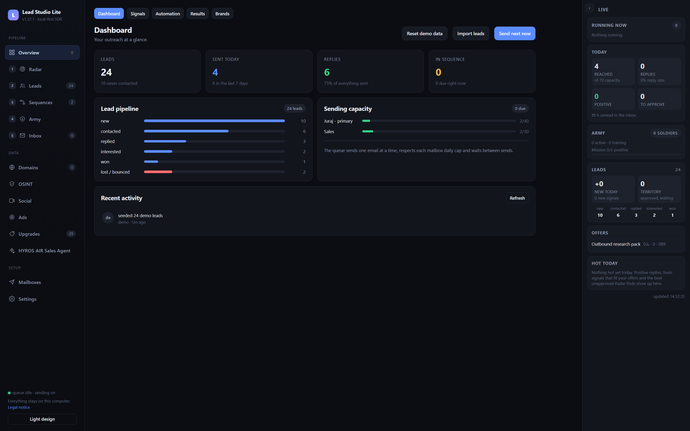

# Lead Studio Lite

A small, local-first **sales development (SDR) app for Windows**. Import leads, verify their email
addresses, send multi-step sequences *from your own mailbox*, and let it stop the sequence the moment
someone replies.

No account, no subscription, no cloud — your lead list never leaves your computer.

**Python 3.9+ · MIT · ~4,000 lines · no runtime dependencies**



---

## Why this exists

Most cold-email tools charge $50–200 a month and keep your prospect list in their database. If you
send a few hundred emails a month, you don't need a sending platform — you need pacing, templates,
reply detection and a place to see who you contacted. That's what this is. One folder, one
double-click, your data in a SQLite file you own.

**Good fit:** freelancers, consultants, small agencies, founders doing their own outbound.
**Bad fit:** high-volume senders (10k+/month), teams needing shared inboxes, anyone wanting
built-in data enrichment.

## Features

- **Import anything** — CSV, TSV, semicolon files, Excel `.xlsx`, Parquet, DuckDB and SQLite.
  Column names are auto-mapped (`Email`, `E-mail`, `Company`, `Job Title`, `Description` …),
  duplicates skipped, invalid addresses reported. **An email is optional**: a company with a
  description, a domain or a name is a contact too, and the rows that have no address simply
  cannot be enrolled in a sequence. Big files (the multi-gigabyte kind) are imported from a path
  on disk — type it or press **Browse** for the system file window — streamed and capped, with an
  optional SQL filter for DuckDB.
- **Bulk data on Hugging Face** — the scraped contact table (`rec_results.duckdb`) is too big for
  a repository, so it is published as the public dataset
  [Jurajbrando/lead-studio-data](https://huggingface.co/datasets/Jurajbrando/lead-studio-data)
  and linked from *Leads → Bulk data*. Re-publish it with `python tools/upload_bulk_data.py`
  (needs a write token).
- **Domains tab** — a catalogue of domains separate from leads. Pull a slice from three open
  datasets on Hugging Face — Common Crawl web graph (370M, ranked), registered domains (~180M),
  daily Certificate Transparency — enrich any of them against the live Common Crawl index, or
  scrape the site for contact details and add what it finds as a lead. The weekly Common Crawl
  job also feeds it from the CC host index, and **Import lead domains** pulls the domain of every
  lead you already have — with an email or with only a domain.
- **Verify before you send** — syntax, typo domains, disposable providers, role accounts (`info@`),
  MX records (`dnspython` → `nslookup` fallback), optional live SMTP probe.
- **Sequences** — unlimited steps, per-step delays, merge fields with fallbacks
  (`{{first_name|there}}`), automatic stop on reply.
- **Sends from your inbox** — SMTP with STARTTLS/SSL, sending window, gap + jitter between messages,
  weekday-only mode, per-mailbox daily cap.
- **Reads your replies** — IMAP polling marks replies and bounces, stops sequences, updates the lead.
- **Local pipeline** — new → contacted → replied → interested → won / lost, plus unsubscribe and
  bounce suppression.
- **Open/click tracking** and **unsubscribe links** (optional; off unless you set a public URL).
- **Daily automation** — scheduled jobs that keep the database fresh: new domains, MX verification,
  US bankruptcy filings, weekly Google Ads Transparency, hiring signals, Common Crawl footprint,
  phishing/fraud watch, and a merge job that folds dropped CSV files into your leads.
- **Contact crawler** — turns a domain into a real lead: reads the site (robots-aware), follows the
  contact/about/team pages, de-obfuscates addresses and ranks them.
- **Optional connectors** — Hunter.io (addresses behind a domain), any OpenAI-compatible AI endpoint
  (segment + angle), Serper (company → website). Off until you add a key.
- **Offers & affiliate links** — add the tools you resell (accounting, ads, social, referrals) with
  their link, keywords and pitch template; leads are matched to the right offer and the email is
  drafted with your link in it. Per-offer connections (link / API key / MCP / webhook), generated
  offer pages with an affiliate disclosure, and a bundled 30-offer starter pack.
  See [docs/OFFERS.md](docs/OFFERS.md).
- **Bring your own LLM** — OpenAI, Anthropic (Claude), DeepSeek, Ollama or any OpenAI-compatible
  endpoint, managed as a list with a default and a test button.
- **Brand watch** — monitor any number of business domains for lookalikes, typosquats and scam
  clones: registered lookalike names, new registrations and phishing listings, with a per-brand case
  file and CSV export. See [docs/BRAND_WATCH.md](docs/BRAND_WATCH.md).
- **MCP server** — `leadstudio_mcp.py` lets Claude Desktop or any MCP client search leads, import
  CSVs, run jobs and read signals. See [docs/MCP.md](docs/MCP.md).
- **Social tab** — make a short video from a title, an audio track and one picture (or a source
  video), then plan, schedule and measure it through Metricool: a unified inbox, a content
  calendar, the Meta/Google/TikTok ad panels and the reporting cards. See [docs/SOCIAL.md](docs/SOCIAL.md).
- **Demo mode** — 24 sample leads and two sequences to explore before touching real data.

| Leads | Sequences |
| --- | --- |
|  |  |

## Download and run

### Option A — from this repository

```bash
git clone https://github.com/<your-account>/lead-studio-lite.git
cd lead-studio-lite
```

Double-click **`START_LEAD_STUDIO.bat`** (or run `python leadstudio.py`). Lead Studio opens in
**its own window** (pywebview + WebView2); if pywebview is not installed it opens in your browser at
`http://127.0.0.1:8791` instead. `--browser` and `--window` force either one, `--no-browser` keeps it
headless. Keep the console window open; closing it stops the app.

Nothing to install: the app is standard-library Python only. Optional extras: `pywebview` (own
window), `openpyxl` (Excel import), `pyarrow`/`duckdb` (Parquet and DuckDB import/export).

### Option B — the standalone `.exe`

Every tagged release attaches `LeadStudio.exe` (and a zip with this README, the docs and the
executable). No Python needed — put it in its own folder and run it; it creates a `data` folder next
to itself.

> Windows SmartScreen may warn about an unsigned executable: *More info → Run anyway*.

### Option C — build it yourself

`BUILD_EXE.bat` runs PyInstaller and produces `dist\LeadStudio.exe`. Requires
`pip install pyinstaller`.

## First run (5 minutes)

1. **Connect a mailbox** — *Mailboxes → Add mailbox*. SMTP for sending, IMAP for replies. Use an
   **app password**, not your account password. Press *Test connection*, then *Send test email*.
2. **Import leads** — *Leads → Import*. Drop a CSV (or Parquet/DuckDB/Excel), or point the
   *File on this computer* tab at a big file and cap the rows. An email column helps but is not
   required; `samples/leads-sample.csv` shows the columns it recognises.
3. **Verify** — one button; red addresses never reach your sequence.
4. **Build a sequence** — day 0 intro, day 3 follow-up, day 7 close. Two or three short emails beat
   one long one.
5. **Enroll** — the queue sends one email at a time, inside your window, under your daily cap.

Full walkthrough, provider settings (Gmail, Outlook, Zoho, Seznam, Websupport), sequence copy tips
and a troubleshooting table: **[docs/GETTING_STARTED.md](docs/GETTING_STARTED.md)**.

## Daily automation

The **Automation** page runs enrichment jobs on a schedule while the app is open. Each one pulls a
public source and writes what it finds into the `domains` and `signals` tables — nothing is emailed
by a job.

| Job | Default | Source |
| --- | --- | --- |
| New domains | daily 06:00 | smet.cz NRD feed (CC BY 4.0) |
| Domain MX verification | daily 04:30 | DNS |
| Bankruptcy & insolvency watch | daily 07:00 | SEC EDGAR 8-K Item 1.03 (UK Gazette / omni as options) |
| Google Ads Transparency | weekly Mon 07:30 | HuggingFace `najeh-halawani/google-ads-transparency` |
| Hiring signals | daily 06:45 | HuggingFace `cleanfeeds/tech-jobs-daily` |
| Common Crawl footprint | daily 03:00 | index.commoncrawl.org |
| Common Crawl host index | weekly Sun 04:30 | HuggingFace `commoncrawl/host-index-testing-v2` |
| Phishing / fraud watch | daily 05:30 | Phishing.Database |
| Merge files into leads | daily 02:00 | your `data/imports/` folder |
| Brand watch | daily 08:00 | DNS + new-domain feed + phishing lists |

Signals are evidence, not contacts: use **To lead** on any signal to turn it into a lead (you supply
the email) and the finding is attached to it. A bankruptcy signal additionally flags existing leads
so you never pitch a company that just filed.

Schedules, parameters and on/off switches live on the Automation page. Details, licences and how to
write your own job: **[docs/AUTOMATION.md](docs/AUTOMATION.md)**.


## What it does not do

- No email warm-up and no deliverability guarantee. A fresh mailbox that sends 100 cold emails on
  day one lands in spam; start at 10–20 a day and raise it slowly.
- No lead scraping, enrichment or buying data.
- No multi-user, no syncing, no cloud backup.
- Does not bypass provider limits — Gmail and Outlook cap daily sending and will lock the account.

Cold email is regulated (GDPR, CAN-SPAM, PECR and local equivalents). The app gives you unsubscribe
links and a suppression list; the legal basis, the list's provenance and the content are yours.
Read [docs/PRIVACY.md](docs/PRIVACY.md) before sending to real people.

## How it works

```
leadstudio.py            entry point, CLI flags
engine/config.py         paths, defaults, settings file
engine/db.py             SQLite schema (leads, sequences, sends, replies, suppressions)
engine/mail.py           SMTP send, IMAP read, template merge, HTML rendering
engine/verify.py         email verification (no required third-party package)
engine/importer.py       CSV/Excel import, column mapping, CSV export
engine/pipeline.py       the sending queue, reply matching, statistics
engine/scheduler.py      job scheduling and run history
engine/net.py            the HTTP layer used by the jobs (gzip, retries, parsers)
engine/jobs/             one module per automation job
engine/server.py         local HTTP API, static files, tracking pixel/redirect
engine/video.py          the Social composer: uploads, the render spec, the task
engine/video_maker.py    the renderer itself (Pillow cover frame + ffmpeg), a child process
engine/metricool.py      the Metricool MCP connection, tools and the section mapping
engine/demo.py           demo dataset
ui/                      single-page interface — plain HTML/CSS/JS, no build step
tests/                   end-to-end tests (fake SMTP server, temp database)
```

The server binds to `127.0.0.1` only and requires a per-run session token on every write, so a
random website you have open cannot poke your local app.

Your data lives in `data/` (git-ignored): `leadstudio.db`, `settings.json` with mailbox credentials
in plain text on your machine, and `logs/app.log`. Delete the folder to remove every trace.

## Development

```bash
python leadstudio.py                  # start
python leadstudio.py --no-browser     # don't open a browser
python leadstudio.py --seed-demo      # start with demo data
python leadstudio.py --port 9000      # different port
python -m unittest discover -s tests -v
```

The test suite spins up a fake SMTP server and a throwaway database — no real email leaves the
machine, and the job tests never touch the network. CI runs it on Windows for Python 3.9 and 3.12
(`.github/workflows/ci.yml`).

## Releases

`git tag v1.0.0 && git push --tags` triggers `.github/workflows/release.yml`, which runs the tests,
builds `LeadStudio.exe` with PyInstaller, and publishes a GitHub Release with:

- `LeadStudio.exe` — standalone Windows executable
- `LeadStudioLite-<tag>-windows.zip` — executable + README + docs
- `LeadStudioLite-<tag>-source.zip` — the source tree

To build the same zip locally: `python tools/package_release.py`.

Step-by-step instructions for GitHub, your own site, Gumroad and other download pages:
**[docs/PUBLISHING.md](docs/PUBLISHING.md)**.

## Repo layout extras

- `samples/leads-sample.csv` — example import file
- `docs/` — getting started, automation, brand watch, offers, connectors, MCP, privacy, publishing
- `marketing/index.html` — optional one-page product site (self-contained, no external assets)

## Contributing

Issues and pull requests are welcome. Keep the app dependency-free: if a feature needs a package,
put it behind an optional import with a graceful fallback. Run the test suite before opening a PR.

## Legal notice

Lead Studio Lite is an independent project. It is **not affiliated with, endorsed by or sponsored
by Metricool** or any other service it connects to.

The Metricool links in this app — the *Get Metricool* button and every *Connect* / *Open* link in
the Social tab — are **affiliate links** (`https://my.mtr.cool/NEMGNE`). If you open a Metricool
account through one, this project may earn a commission at no extra cost to you. Metricool's own
terms and privacy policy apply to your account.

The app is provided as is, under the MIT licence, without warranty. You are responsible for the
messages you send and for the data you import — cold email is regulated (GDPR, CAN-SPAM, PECR and
local equivalents). See [docs/PRIVACY.md](docs/PRIVACY.md).

## License

MIT — see [LICENSE](LICENSE). Use it, rebrand it, give it away.
