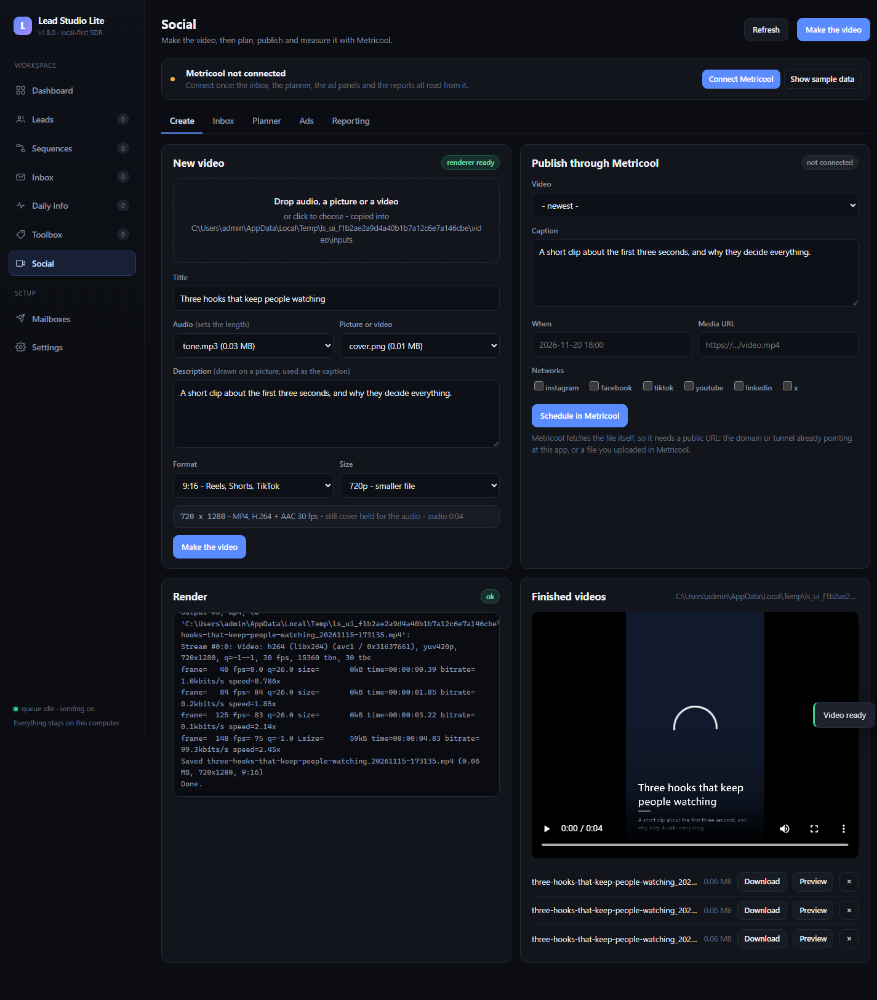
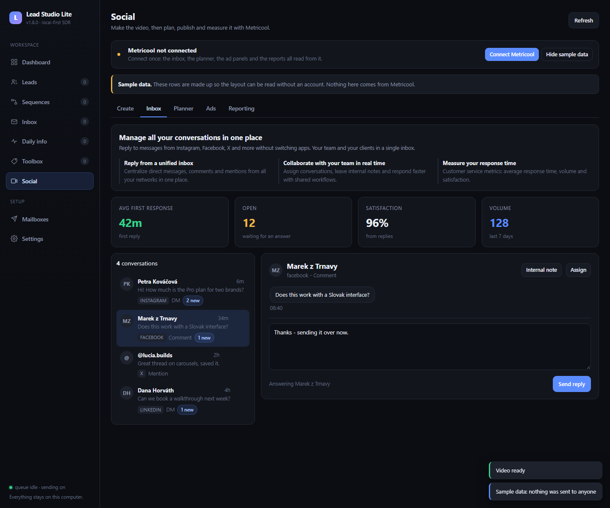
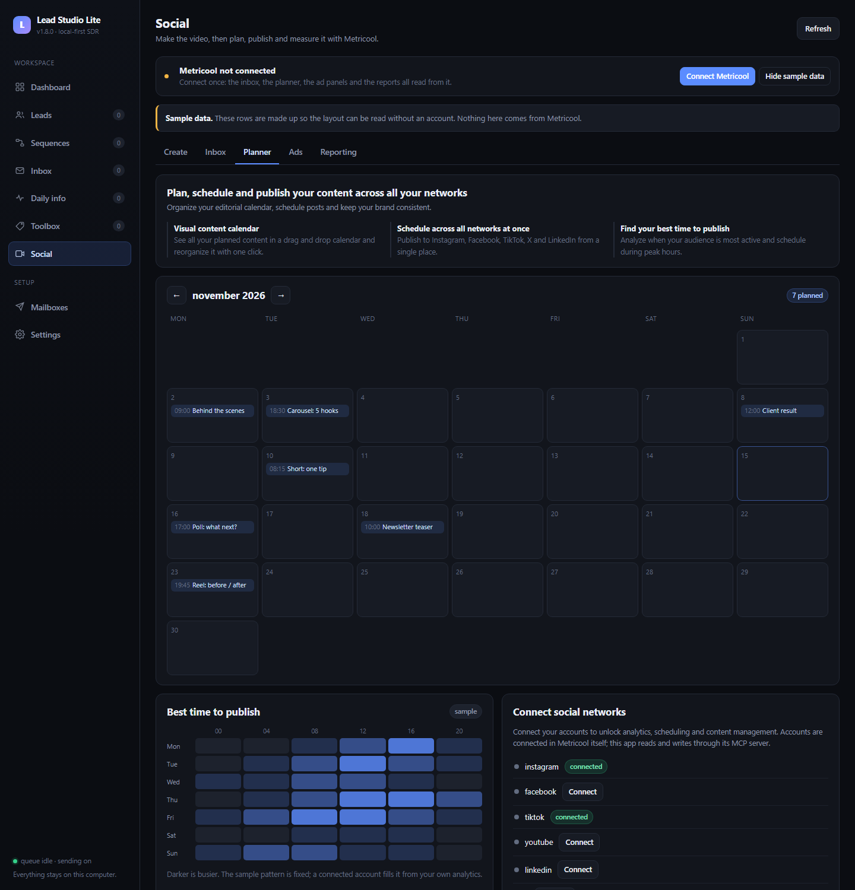
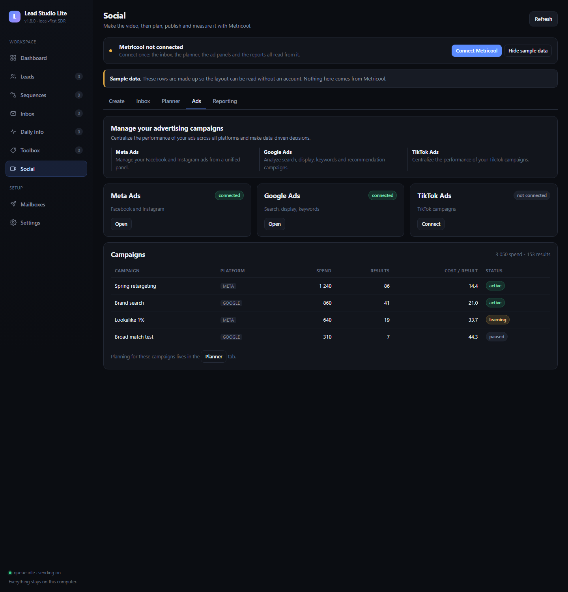
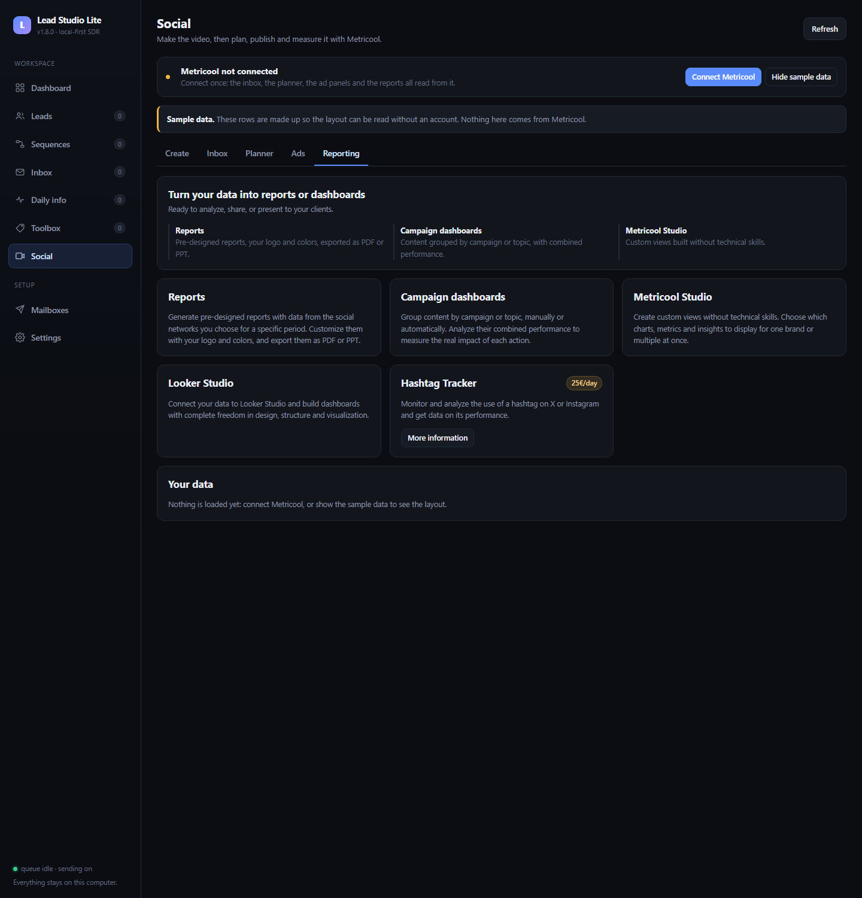

# Social: the composer, and Metricool around it

The **Social** tab is one workspace with five panes:

| Pane | What it is for |
| --- | --- |
| **Create** | make the video: title, audio, a picture or a video, description, format, size |
| **Inbox** | the unified inbox: conversations from every network, replies, notes, response times |
| **Planner** | the editorial calendar, the best time to publish, the network connections |
| **Ads** | Meta, Google and TikTok campaigns in one table |
| **Reporting** | reports, campaign dashboards, Studio, Looker Studio, Hashtag Tracker |

Everything that needs an account goes through **Metricool's MCP server**. Nothing else leaves
this computer: the video is rendered here, and only what you explicitly schedule is sent.

| Create | Inbox |
| --- | --- |
|  |  |

| Planner | Ads | Reporting |
| --- | --- | --- |
|  |  |  |

The screenshots use the labelled sample data, so no account details are in them.

---

## 1. Create

### The five inputs

| Input | Notes |
| --- | --- |
| **Title** | drawn on a picture cover, and used as the file name |
| **Audio** | sets the length of the video when the source is a picture |
| **Picture or video** | one of the two; a picture is cover-cropped, a video is scaled and cropped |
| **Description** | drawn under the title on a picture cover, and the default caption for the post |
| **Format + size** | the output geometry (below) |

Format: `16:9` (YouTube, Facebook, LinkedIn), `9:16` (Reels, Shorts, TikTok), `1:1` (square feed),
`4:5` (Instagram and Facebook feed). Size: `1080p`, `720p`, `480p` - applied to the format's own
frame, so 9:16 at 720p is 720x1280, not 1280x720.

### What comes out

An MP4, H.264 video + AAC audio, 30 fps, `+faststart`, in `data/video/output/`. The list under
**Finished videos** plays it, downloads it and removes it.

* **A picture** becomes a still cover: the picture is cover-cropped, a gradient is laid over the
  lower part so white text always reads, and the title and description are drawn on it. The frame
  is held for the length of the audio.
* **A video** keeps its own motion: it is scaled and cropped to the format, and the audio track
  replaces its sound. No audio is fine here - the source's own sound is kept.

Rendering runs as a child process, so the app stays usable, the log streams into the page, and
**Cancel** stops ffmpeg.

### What it needs

`ffmpeg` on `PATH` (or the copy inside `imageio-ffmpeg`), and Pillow. Nothing else - no whisper,
no model download. The composer shows **renderer ready** or the missing pieces in amber.

### Files

```
data/video/inputs/    audio, pictures, source videos
data/video/output/    the rendered .mp4 files
data/video/work/      the spec files and the composed cover frame (safe to delete)
```

Uploads are capped at 400 MB and the name is reduced to a bare file name, so nothing can be
written outside those folders.

---

## 2. Inbox

One list of conversations, one thread on the right: reply from here, leave an **internal note**
(kept in this app, never sent), and **assign** the thread to a teammate (also kept here). The four
numbers at the top are the customer-service ones: average first response, open conversations,
satisfaction and volume. They are computed from whatever the conversation tool returns.

Metricool decides whether an inbox tool exists at all. If the account exposes one, *Ask Metricool
again* pulls it; if not, the pane says so.

---

## 3. Planner

The month calendar, Monday first, with a chip per planned post. The arrows move by month. On the
right: **Best time to publish** (a weekday x 4-hour grid) and **Connect social networks** - accounts
are connected inside Metricool; this app reads and writes through its MCP server.

---

## 4. Ads

Three panels - Meta Ads, Google Ads, TikTok Ads - and one campaign table with spend, results, cost
per result and status. **Connect** opens Metricool; **Load** asks the account for the numbers.

---

## 5. Reporting

The five Metricool outputs, described where they happen rather than reimplemented here:

* **Reports** - pre-designed reports per network and period, your logo and colours, PDF or PPT.
* **Campaign dashboards** - content grouped by campaign or topic, combined performance.
* **Metricool Studio** - custom views without technical skills.
* **Looker Studio** - connect the data and build the dashboard yourself.
* **Hashtag Tracker** - a hashtag on X or Instagram, **25 €/day**, with a link to Metricool.

Without a connected brand the pane shows the empty state - *your brand has no connected
networks* - and a button to connect.

---

## Metricool: how the connection works

The REST API is only included in **Advanced** and **Custom** plans. The **MCP server**
(`https://ai.metricool.com/mcp`) works on every plan, including **Free**, so that is the one used:
the account's own limits still apply (1 brand, 20 posts a month, 30 days of analytics, no LinkedIn
or X).

1. *Connect Metricool* registers the app on the fly (OAuth dynamic client registration, public
   client, PKCE S256) and opens the browser.
2. You approve; Metricool redirects to `http://127.0.0.1:<port>/oauth/metricool/callback`.
3. Tokens are stored in `data/settings.json` next to the mailbox credentials and refreshed when
   they expire.
4. After that, every call is JSON-RPC to the MCP endpoint with a bearer token.

*Disconnect* throws the tokens away. Metricool keeps the app authorised on its side; remove it
there (Settings -> connected apps) to be rid of it entirely.

### Sections are matched, not hard-coded

The tab asks for `tools/list` and maps a tool to each section by name, then by description. The
tool list is cached for a minute, and **Load tools** forces a fresh read. If you want to see the
raw answer - including the arguments that were sent - it is printed under the pane.

The two original helpers are still there: *Schedule in Metricool* maps caption / when / networks /
media URL onto whatever the scheduling tool calls them, and any tool can be run by hand through
`POST /api/social/metricool/call`.

### Sample data

Every pane has a **Show sample data** toggle. It fills the layout with obviously fake rows and says
so in a banner. It is there to read the design without an account - never as a stand-in for your
numbers.

### The media URL

Metricool fetches the file itself, so it needs a **public URL**:

* **You already expose the app** for tracking (*Settings -> tracking base url*, a tunnel or your
  own domain). Finished videos are then served at `https://your-base/t/v/<file name>.mp4` and the
  field is filled in for you.
* **Upload the video in Metricool** and paste the URL it gives you.

While the app is closed or the tunnel is down, that URL is dead - schedule first, then leave the
app running until Metricool has fetched the file.
